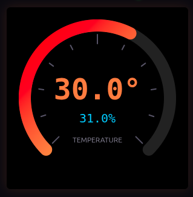

# 🌡️ Temperature Sensor — DHT11 + Arduino Uno

Digital temperature and humidity display with a **thermometer-style** visualization, reading data from the DHT11 sensor via serial and rendering in real-time in the browser.



## Hardware

| Component | Wiring |
|---|---|
| **DHT11** | VCC→5V, GND→GND, DATA→D2 |
| **Arduino Uno R3** | Connected via USB |

## Software

- **Arduino sketch** (`tempperature.ino`): reads the DHT11 and sends JSON over serial every 2 seconds
- **Web page** (`tempperature.html`): vertical thermometer with temperature level and humidity — uses **Web Serial API** (Chrome/Edge)

## Usage

1. **Upload the sketch** to the Arduino:
   ```bash
   arduino-cli compile --fqbn arduino:avr:uno tempperature
   arduino-cli upload -p /dev/ttyACM0 --fqbn arduino:avr:uno tempperature
   ```

2. **Open** `tempperature.html` in Chrome or Edge

3. **Click "Connect"** and select the Arduino serial port

4. **Watch** the thermometer rise and fall with temperature changes

## Data format

```json
{"h":45.0,"t":23.5}
```

| Field | Description |
|---|---|
| `h` | Humidity in % (0-100) |
| `t` | Temperature in °C |

## Structure

```
temperature/
├── tempperature.ino    # Arduino sketch (DHT11 → Serial JSON)
├── tempperature.html   # Thermometer web page (Web Serial API → Canvas)
├── screenshot.png      # Thermometer screenshot
└── README.md           # This file
```
